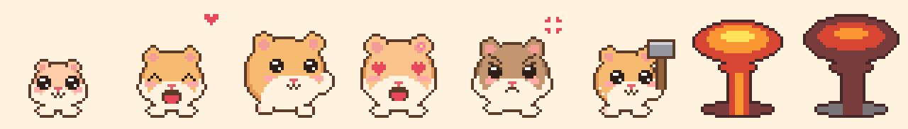
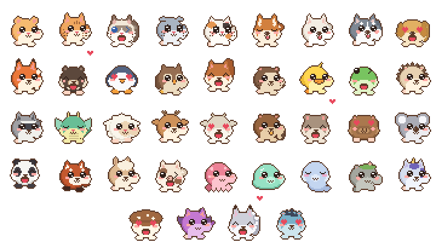

# Bolok — a pixel hamster desktop pet for Windows



<p align="center"></p>

**Bolok (볼록이)** is a tiny hamster that lives on your Windows desktop while you work.
Feed it, pet it, toss it around — and when you need a break, let it smash your windows with a minigun.
A tamagotchi-like virtual pet, drawn entirely in generated pixel art.

[한국어 설명은 아래에 있어요](#한국어)

## Download

Get **`Bolok.exe`** from the [latest release](https://github.com/goldfinger8157/bolok-desktop-pet/releases/latest) and run it. No installer, no runtime to install.

- Windows 10/11, 64-bit.
- The exe is not code-signed, so the first run shows a SmartScreen warning: click **More info → Run anyway**.
- Your pet is saved in `%APPDATA%\Bolok`.
- **Pets are downloaded as they hatch:** the exe only carries the hamster. When a new egg arrives, Bolok downloads that one pet's picture (about 300 KB) from this repository, at the tag of the version you run, and uses it only if its size and SHA-256 match the list built into the exe. Pictures are kept in `%LOCALAPPDATA%\Bolok\pets`. If you're offline until the egg hatches, a pet you already have hatches instead.
- **Updating:** download the new `Bolok.exe` from the releases page and replace the old file. Auto-update is **off by default**; if you turn it on (right-click → 설정... → 업데이트), Bolok checks this repository once a day, downloads a newer `Bolok.exe`, and switches to it the next time it starts.

## What it does

- **Lives on your screen:** wanders across all monitors, naps on top of windows, hides behind them and peeks out, and gets out of the way of the window you are working in.
- **Needs care:** hunger, mood and energy change over the day. Neglect it and it starts eating holes in your screen.
- **Reacts to you:** click to pet, drag to carry, fling it and it bounces off the screen edges, shake it and it gets dizzy.
- **Grows up:** egg → baby → child → one of three adult forms, depending on how you raised it.
- **34 kinds of pets:** hamster, cat, shiba, fox, moon bear, penguin, owl, squirrel, otter, duck, frog, hedgehog, raccoon, baby dragon, sheep, deer, goat, beaver, quokka, capybara, koala, panda, red panda, alpaca, pig, octopus — and fantasy friends: slime, ghost, little golem, unicorn, mushroom sprite, little imp, gumiho (nine-tailed fox), little dokkaebi (Korean goblin). You don't pick one — you find out when the egg hatches. When it's time, **release** your pet to nature (Settings → 도감) and a new mystery egg arrives. The collection book shows who you've met.
- **Speaks in emotes**, not text.

### Mini-games (right-click menu)

| Game | What happens |
| --- | --- |
| Shooting (총쏘기 게임) | 10 seconds to hit the fleeing hamster inside one window |
| Runner (달리기 게임) | Cookie-Run-style runner along the bottom of the screen, keyboard only, with levels |
| Breakout (벽돌깨기) | Your windows become bricks; the hamster carries the paddle |
| Minigun (미니건) | Unlimited minigun and grenades versus your windows. No score, just stress relief |
| Fortress (포트리스) | Turn-based artillery on window islands, with wind |
| ICBM (ICBM 발사) | The hamster presses the red button, a mushroom cloud follows, then it walks over and repairs the crater |

Nothing in the games touches your real windows: the damage is drawn on a click-through overlay and disappears when the game ends.

## Build from source

Requires the [.NET 10 SDK](https://dotnet.microsoft.com/download) on Windows.

```
dotnet build app/Bolok.csproj -c Release -o out
out\Bolok.exe --selfcheck   # rule tests (exit code 0 = pass)
out\Bolok.exe
```

- `app/` — the C# WinForms app. Game and pet rules are plain classes checked by `--selfcheck`.
- `tools/sprites.py` — generates every sprite (`assets/sprites.png`, `assets/sprites.json`) with the Python standard library only.
- Pushing a tag like `v1.2.3` builds the single-file exe and publishes a release (`.github/workflows/release.yml`).

## License

[MIT](LICENSE)

---

## 한국어

**볼록이**는 일하는 동안 윈도우 화면에서 키우는 도트 햄스터예요. 밥 주고, 쓰다듬고, 집어 던지고, 쉬고 싶을 땐 미니건으로 창을 부숴요.

### 받기

[최신 릴리스](https://github.com/goldfinger8157/bolok-desktop-pet/releases/latest)에서 **`Bolok.exe`** 하나만 받아 실행하면 돼요. 설치 과정도, 따로 깔 것도 없어요.

- 윈도우 10/11 64비트에서 돼요.
- 서명이 없는 exe라 처음 실행할 때 "Windows의 PC 보호" 경고가 떠요. **추가 정보 → 실행**을 누르면 돼요.
- 키우던 볼록이는 `%APPDATA%\Bolok`에 저장돼요.
- **캐릭터 그림은 알이 생길 때 받아요:** exe 에는 햄스터만 들어 있어요. 새 알이 오면 그 친구 그림 하나(약 300KB)를 이 저장소의 「쓰고 있는 버전 태그」에서 받고, exe 안 목록과 크기·SHA-256 이 맞을 때만 써요. 받은 그림은 `%LOCALAPPDATA%\Bolok\pets` 에 남아요. 알이 깨질 때까지 인터넷이 안 되면, 이미 가진 친구 중에서 나와요.
- **업데이트:** 릴리스 페이지에서 새 `Bolok.exe`를 받아 쓰던 파일에 덮어쓰면 돼요. 자동 업데이트는 **기본으로 꺼져 있어요.** 오른쪽 클릭 → `설정...` → `업데이트` 탭에서 켜면, 하루에 한 번 이 저장소에서 새 `Bolok.exe`를 자동으로 내려받고 다음에 켤 때 새 버전으로 바뀌어요.

### 하는 일

- **화면에서 살아요:** 모니터를 넘나들며 돌아다니고, 창 위에서 자고, 창 뒤에 숨어 빼꼼 내다보고, 일하는 창은 피해 줘요.
- **돌봐야 해요:** 배고픔, 기분, 기운이 하루 동안 변해요. 내버려 두면 화면을 뜯어 먹어요.
- **반응해요:** 클릭하면 쓰다듬기, 끌면 들기, 던지면 화면 끝에서 튕기고, 흔들면 어지러워해요.
- **자라요:** 알 → 아기 → 어린이 → 키운 방식에 따라 세 가지 어른 모습 중 하나가 돼요.
- **34종 친구들:** 햄스터, 고양이, 시바견, 여우, 반달가슴곰, 펭귄, 부엉이, 다람쥐, 수달, 오리, 개구리, 고슴도치, 너구리, 아기 용, 양, 사슴, 염소, 비버, 쿼카, 카피바라, 코알라, 판다, 레서판다, 알파카, 돼지, 문어, 그리고 판타지 친구들 슬라임, 유령, 꼬마 골렘, 유니콘, 버섯 요정, 꼬마 악마, 구미호, 꼬마 도깨비. 고를 수는 없고, 알이 깨져야 누가 나올지 알아요. 때가 되면 설정 → 도감에서 **풀어주기**로 자연에 보내 주고, 무엇이 나올지 모르는 새 알을 키워요. 도감에는 만나 본 친구들이 남아요.
- **글자 대신 이모티콘**으로 말해요.

### 미니 게임 (오른쪽 클릭 메뉴)

| 게임 | 내용 |
| --- | --- |
| 총쏘기 게임 | 10초 동안 창 하나 안에서 도망 다니는 볼록이 맞히기 |
| 달리기 게임 | 화면 아래를 달리는 쿠키런식 게임. 키보드만 쓰고 레벨이 올라요 |
| 벽돌깨기 | 창이 벽돌이 되고, 볼록이가 쟁반으로 쇠공을 튕겨요 |
| 미니건 | 탄창 없는 미니건과 수류탄으로 창 부수기. 점수 없이 스트레스 풀기용이에요 |
| 포트리스 | 창이 섬이 되는 턴제 포격전. 바람이 불어요 |
| ICBM 발사 | 볼록이가 빨간 버튼을 누르면 버섯구름이 피고, 볼록이가 걸어가서 고쳐요 |

게임은 실제 창을 건드리지 않아요. 부서진 모습은 클릭이 통과하는 그림 위에만 그려지고, 게임이 끝나면 사라져요.

### 소스에서 빌드하기

윈도우에 [.NET 10 SDK](https://dotnet.microsoft.com/download)가 필요해요.

```
dotnet build app/Bolok.csproj -c Release -o out
out\Bolok.exe --selfcheck
out\Bolok.exe
```

`v1.2.3` 같은 태그를 올리면 깃허브 액션이 exe 한 파일을 만들어 릴리스에 올려요.
